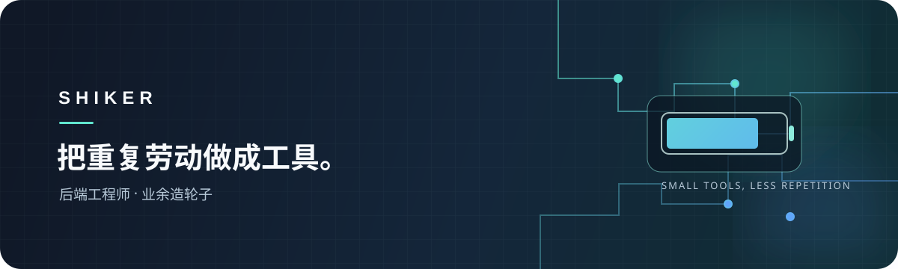

  
   
  
<strong>后端工程师 · 业余造轮子</strong>

  
做 IDEA 插件、内容生产工作台，也做让日常少折腾一点的小工具。

  

    <a href="https://shiker.tech">博客 shiker.tech</a> · 公众号「橙序员」
  

---

### 技术方向

  
  
  
  
  

### 精选作品

| 项目 | 做什么的 |
| --- | --- |
| [见字](https://github.com/shiker1996/wechat-newsroom-workbench) | 本地优先的公众号编辑工作台：采集 → 成稿 → 排版，全链路本机完成 |
| [enc-encrypt](https://github.com/shiker1996/enc-encrypt) | IDEA 插件，Spring Boot Jasypt 加密配置的可视化加解密 |
| [LogiBattery](https://github.com/shiker1996/logi-battery) | Windows 键鼠电量面板，显示兼容 Logitech HID++ 设备电量并提供低电量提醒 |
| [stop-live-bilibili](https://github.com/shiker1996/stop-live-bilibili) | 浏览器插件，在 B 站屏蔽直播入口，还你干净的视频体验 |

---

  把重复劳动做成工具 · Made by Shiker

